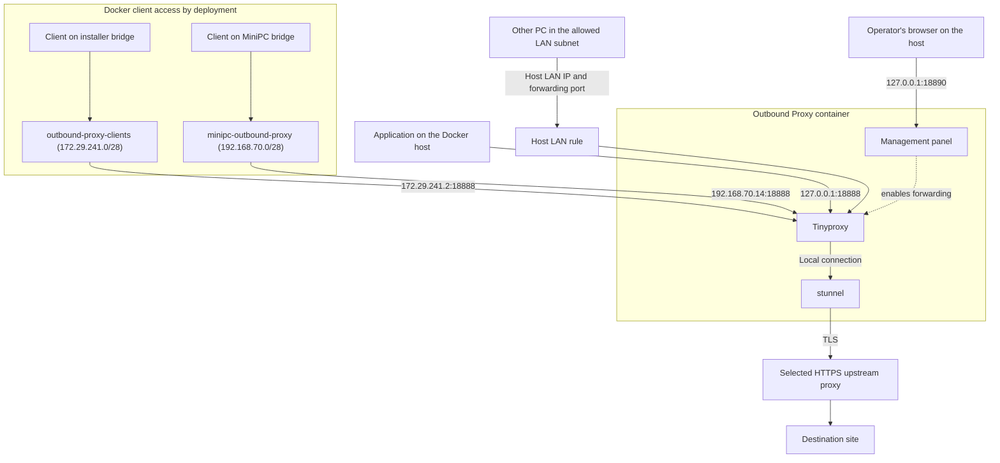

# Standalone outbound proxy

Outbound Proxy gives applications on one host a single HTTP proxy address. It forwards their requests through an authenticated HTTPS proxy that you supply. Configure the upstream credentials once, then point each application at `http://127.0.0.1:18888`. When you switch upstreams, the applications keep the same settings.

## Who it is for

- **Developers** can send requests from a browser, CLI tool or other proxy-aware application through a chosen upstream without copying its credentials into each tool.
- **Host administrators** can check several named upstreams, select one in the local web panel and enable automatic failover if needed.
- **Operators of shared development hosts** can grant selected Docker containers or a permitted LAN subnet access to forwarding. With the default Docker installation, both forwarding and management are local to the host.

## How a request reaches its destination

On the Docker host, applications use the loopback forwarding address. Other PCs can use the host's LAN address when LAN forwarding is enabled. For Docker clients, the diagram shows two alternative deployments. Each client uses the proxy address on its own bridge. The management panel stays on host loopback.



Tinyproxy supplies the upstream credentials. stunnel verifies the upstream certificate and hostname before carrying the request over TLS.

- **LAN PCs.** Select the host's LAN IPv4 address and the permitted source subnet. For example, if the host is `192.0.2.10` and the permitted subnet is `192.0.2.0/26`, a PC in that subnet uses `http://192.0.2.10:18888` at the default forwarding port. Substitute your own LAN values. [LAN setup on Linux](docs/container-install.md#lan-forwarding-on-linux-engine)
- **Docker containers.** With the repository installer, enable the client network, attach each intended container to `outbound-proxy-clients`, then enable Docker forwarding in the panel. Clients use `http://172.29.241.2:18888` even if the published host port changes. In the MiniPC deployment shown above, the bridge gateway is `192.168.70.1` and the proxy container's URL is `http://192.168.70.14:18888`. [Docker client setup](docs/container-install.md#docker-clients-and-inventory)

## Docker quick start

Install Docker Engine 28+ and Compose 2.33.1+ on Linux, or start Docker Desktop with those versions on macOS or Windows. Select a local context running Linux containers. The defaults require free ports 18888 and 18890 and an unused subnet `172.29.240.0/28`. Have the DNS hostname, username and password of your HTTPS upstream ready.

### Get the release installer

All three installers pull `ghcr.io/ikeniborn/outbound-proxy:stable` and record its immutable digest. The release workflow updates this tag when it publishes the GitHub release marked **Latest**.

Open the [latest release](https://github.com/ikeniborn/outbound-proxy/releases/latest). Once its **Publish verified image** run has succeeded, download **Source code (zip)** from the release assets and extract it. Open a terminal in the extracted directory containing `compose.yaml`. If the package is private, sign in to GHCR in the Docker context used for installation.

This quick start requires a published stable image. Before the first release, the release link returns 404 and the registry has no stable image to pull.

### Linux

Install Python 3.9+, curl, iproute2 and nftables. Run the installer in the administrative Docker context.

```bash
sudo sh scripts/docker-proxy.sh install --image ghcr.io/ikeniborn/outbound-proxy:stable
```

### macOS

Install Python 3.9+ and curl. Start Docker Desktop and wait for its engine to be ready. Run these commands in Terminal as the signed-in Desktop user.

```bash
sh scripts/docker-proxy.sh install --image ghcr.io/ikeniborn/outbound-proxy:stable
sh scripts/docker-proxy.sh status
```

### Windows

Start Docker Desktop in Linux container mode. Open Windows PowerShell 5.1 or newer in the extracted directory under the same Windows account. A fresh local-only installation uses a regular PowerShell session.

```powershell
.\scripts\docker-proxy.ps1 install -Image ghcr.io/ikeniborn/outbound-proxy:stable
.\scripts\docker-proxy.ps1 status
```

### Enable forwarding and verify the connection

On the Docker host, open the [local management panel](http://127.0.0.1:18890/). Add your HTTPS upstream, run its check, select it and enable forwarding. The container edition opens the panel without a pairing code.

On Linux or macOS, run:

```bash
curl --fail --show-error --noproxy '' --proxy http://127.0.0.1:18888 https://example.com/
```

In Windows PowerShell, run:

```powershell
curl.exe --fail --show-error --noproxy unused.invalid --proxy http://127.0.0.1:18888 https://example.com/
```

A successful request prints the example page. Set your application's HTTP proxy to `http://127.0.0.1:18888`. The panel stays available when forwarding is disabled. For access from another PC, follow the platform-specific LAN instructions. LAN forwarding has been exercised with a second machine on Linux Engine. Physical Desktop acceptance on Windows and macOS is pending.

- [Container installation, LAN and Docker client access, backup and rollback](docs/container-install.md)
- [Image channels and release selection](docs/image-channels.md)

## Native installation

Use system Python 3.9 or later. On Debian or Ubuntu with systemd, install the executable dependencies.

```bash
sudo apt-get install python3 tinyproxy-bin stunnel4 curl ca-certificates openssl
```

The panel uses the system OpenSSL executable to verify browser signatures. On macOS, supply the Apple system Python through Command Line Tools and install the forwarding binaries with Homebrew as your normal user. The installer preflights the required paths and privileges.

```bash
brew install tinyproxy stunnel
```

If this host already runs the legacy MiniPC proxy, follow [the staging and migration procedure](docs/operations.md#migrate-an-existing-minipc). Staging installs the new CLI alongside the running proxy. The operator switches traffic separately.

For a fresh host or an installation with an accepted migration, run the installer from this repository with administrative privileges. Repeating the install preserves the catalog and active settings.

```bash
sudo sh scripts/install-outbound-proxy.sh
```

Open [the local panel](http://127.0.0.1:18890/) on the installed host and pair the browser using the code from the installation terminal. See the [browser guide](docs/operations.md#open-the-browser-panel) for unattended installations.

On Linux the installed command is in `/usr/local/bin`. On macOS, open a new login shell or invoke the command by its full path in `/Library/PrivilegedHelperTools/outbound-proxy/`.

## Operator guides

- [Configure forwarding, manage upstreams and migrate MiniPC](docs/operations.md)
- [Remove the standalone services](docs/operations.md#remove-the-standalone-services)
- [Operate the legacy MiniPC service](docs/legacy-minipc.md)
- [Installation and verification scripts](scripts/)
- [Proxy tests](tests/)
